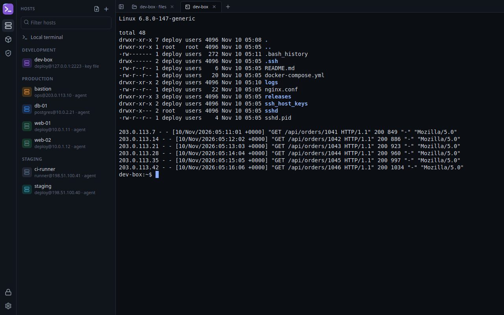
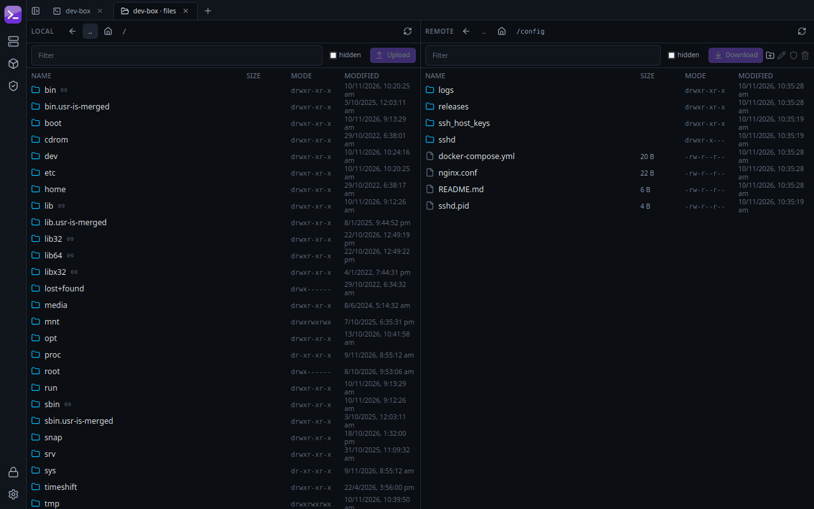
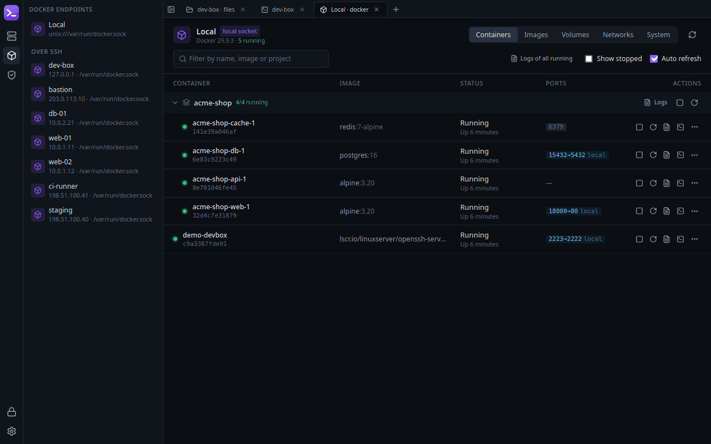
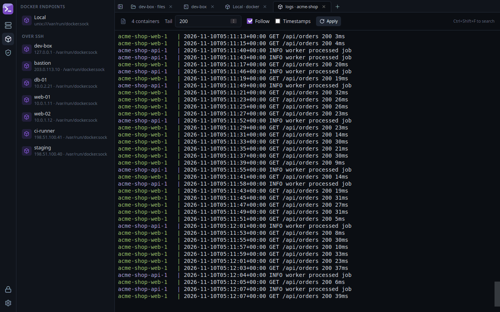
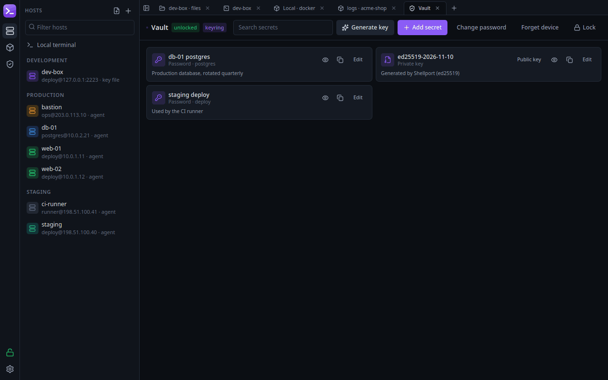
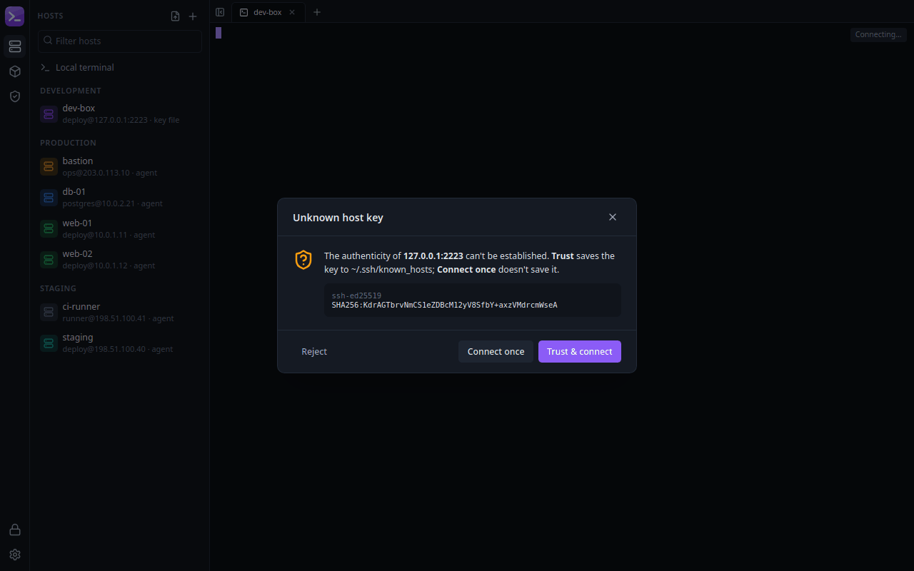

<div align="center">


# Shellport

**SSH, SFTP and Docker in one native Linux app.**

Terminals, file transfers, containers and an encrypted secrets vault, all in a single fast desktop window.

[](https://github.com/EarvinInk/shellport/releases/latest)
[](#install)
[](LICENSE)



</div>

---

## Contents

- [What Shellport offers](#what-shellport-offers)
- [Install](#install)
- [Getting started](#getting-started)
- [Keyboard shortcuts](#keyboard-shortcuts)
- [Security and privacy](#security-and-privacy)
- [Uninstall](#uninstall)
- [Build from source](#build-from-source)
- [License](#license)

## What Shellport offers

### Terminals and saved hosts

- Tabbed **SSH** and **local** terminals with search, four colour themes, and one-click reconnect.
- Save hosts in **groups** (Production, Staging, …) with colours and tags.
- Sign in with a **password, a key in the vault, a key file, or ssh-agent**.
- **Two-factor (keyboard-interactive) logins**, e.g. one-time codes.
- **Jump hosts (ProxyJump)**: reach private servers through a bastion.
- **Port forwarding** (`ssh -L`) per host, with optional auto-start on connect.
- **Import from `~/.ssh/config`** (including `Include`, `Host *` defaults and `ProxyJump`).
- A **startup command** per host, e.g. `cd /srv/app`.
- **Hide the sidebar** (Ctrl+Shift+B) when you want the whole window for the terminal.

### SFTP file manager



- **Dual-pane** local ↔ remote browser.
- Upload and download whole folders with **progress and cancel**; asks before overwriting local files.
- **Drag and drop** files from your desktop file manager to upload.
- Create folders, rename, change permissions (chmod), and delete on the server.

### Docker, local or over SSH



- Manage the **local Docker engine** or **any SSH host** (no Docker port needs to be exposed).
- Containers **grouped by Compose project**; start, stop, restart, pause, kill and remove, or open a shell inside a container.
- **Live logs** for one container or **all containers of a project, merged and colour-coded**:



- **Images, volumes and networks**: pull and remove images (including from private registries); inspect and remove volumes and networks.
- **Disk usage and cleanup** (prune) in the System tab.

### Encrypted vault



- Keep **passwords, private keys and API tokens** in one encrypted file, protected by a master password.
- **Generate ed25519 keys** and copy the public key for a server's `authorized_keys`.
- **Auto-lock** after a period of inactivity.
- Optionally **remember the vault** in your login keyring (GNOME Keyring / KWallet) so it unlocks when you log in.

### Safe by default



- Every server's identity is checked against `~/.ssh/known_hosts`. New servers show their fingerprint before anything is sent; a **changed key** is blocked with a clear warning.
- See [Security and privacy](#security-and-privacy) for details.

## Install

Shellport runs on 64-bit Linux (x86_64). It's developed and tested on Linux Mint 22, and should work on Ubuntu 22.04+, Debian 12+ and other current distributions that ship WebKitGTK 4.1.

Download the latest version from the **[Releases page](https://github.com/EarvinInk/shellport/releases/latest)**. There are two formats:

| File | Best for | Size |
|---|---|---|
| `Shellport_<version>_amd64.deb` | Ubuntu, Debian, Linux Mint, Pop!_OS | ~7 MB |
| `Shellport_<version>_amd64.AppImage` | Any distribution, no install needed | ~85 MB |

### Option A: .deb package (recommended on Ubuntu/Debian/Mint)

1. Download `Shellport_<version>_amd64.deb` from the [Releases page](https://github.com/EarvinInk/shellport/releases/latest).
2. Open a terminal in your Downloads folder and run:

   ```bash
   sudo apt install ./Shellport_*_amd64.deb
   ```

   apt installs the two system libraries Shellport needs (WebKitGTK and GTK) if they aren't already present.
3. Open **Shellport** from your applications menu, or run `shellport` in a terminal.

To update, download the newer `.deb` and run the same command.

### Option B: AppImage (any distribution)

1. Download `Shellport_<version>_amd64.AppImage` from the [Releases page](https://github.com/EarvinInk/shellport/releases/latest).
2. Make it executable and run it:

   ```bash
   chmod +x Shellport_*_amd64.AppImage
   ./Shellport_*_amd64.AppImage
   ```

   You can also right-click the file → **Properties** → **Permissions** → *Allow executing file as program*, then double-click it.

> **AppImage won't start?** AppImages need FUSE 2. Install it with
> `sudo apt install libfuse2t64` (Ubuntu 24.04+) or `sudo apt install libfuse2` (Ubuntu 22.04 / Debian).

## Getting started

1. **Create your vault.** On first launch, open the **Vault** (shield icon on the left) and choose a master password. It encrypts everything you store and **cannot be recovered**, so keep it safe. Tick *Unlock automatically via system keyring* if you don't want to type it after every login.
2. **Add your servers.** Either:
   - click **+** in the Hosts panel and fill in name, address, user and how to sign in, or
   - click the **import** icon next to it to bring in hosts from your `~/.ssh/config`.
3. **Connect.** Double-click a host. The first time, Shellport shows the server's fingerprint; check it and choose **Trust & connect**.
4. **Transfer files.** Hover a host and click the **folder** icon to open SFTP. Select a file or folder and use **Upload** / **Download**, or drag files in from your desktop.
5. **Manage containers.** Click the **cube** icon on the left, then pick **Local** or any SSH host.
6. **Forward a port.** Hover a host, click the **⇄** icon and add a forward, e.g. local `15432` → `127.0.0.1:5432` to reach a remote database.
7. **Make it yours.** Theme, font, cursor, auto-lock time and more are under **Settings** (gear icon).

## Keyboard shortcuts

| Shortcut | Action |
|---|---|
| Ctrl+Shift+T | New local terminal |
| Ctrl+Shift+W | Close tab |
| Ctrl+PgUp / Ctrl+PgDn | Previous / next tab |
| Ctrl+Shift+B | Show / hide the sidebar |
| Ctrl+Shift+C / Ctrl+Shift+V | Copy / paste in the terminal |
| Ctrl+Shift+F | Search in the terminal or logs |
| Middle-click a tab | Close it |

## Security and privacy

- **No telemetry, no accounts, no cloud.** Shellport only connects to the servers and Docker engines you tell it to.
- **Vault encryption:** Argon2id (64 MiB, 3 passes) derives the key from your master password; contents are encrypted with XChaCha20-Poly1305, and any tampering with the file is detected.
- **Remembered vaults** store the vault key in your login keyring. Any program running as you can read it while the keyring is unlocked, so leave this off on shared machines.
- **Host keys** are verified against `~/.ssh/known_hosts` (hashed names, wildcards and `@revoked` entries included). On a changed key Shellport sends no password or key unless you explicitly replace the saved key.
- **Downloads** never write outside the folder you choose and never follow symlinks, even if a server sends hostile file names.
- **Links** in terminal output open in your browser only after you confirm, and only `http(s)` links.
- Your data lives in `~/.config/shellport/` (`hosts.json`, `settings.json`, `vault.bin`), readable only by you (mode 0600).

Found a security issue? Please report it privately via [GitHub security advisories](https://github.com/EarvinInk/shellport/security/advisories/new) rather than a public issue.

## Uninstall

```bash
sudo apt remove shellport
```

For the AppImage, just delete the file. Your hosts, settings and vault stay in `~/.config/shellport/`; delete that folder too if you want to remove everything (this permanently deletes your vault).

## Build from source

You need Rust (stable), Node.js 20+ with pnpm, and the WebKitGTK development packages:

```bash
sudo apt install libwebkit2gtk-4.1-dev build-essential curl wget file libxdo-dev libssl-dev libayatana-appindicator3-dev librsvg2-dev libdbus-1-dev
```

```bash
git clone https://github.com/EarvinInk/shellport.git
cd shellport
pnpm install
pnpm tauri dev                                   # run in development
pnpm tauri build --bundles deb,appimage          # → src-tauri/target/release/bundle/
```

Run the tests with `cd src-tauri && cargo test`. A full release build needs about 5 GB of free disk space.

Official downloads are built by GitHub Actions ([`.github/workflows/release.yml`](.github/workflows/release.yml)) on Ubuntu 22.04, so they run on that release and newer. Packages you build yourself only run on your distribution version or newer. To publish a release, bump the version in `src-tauri/tauri.conf.json`, `src-tauri/Cargo.toml` and `package.json`, then push a matching tag (`git tag v0.2.0 && git push origin v0.2.0`). The workflow creates a draft release with both packages attached for you to review and publish.

<details>
<summary>Test servers and project layout</summary>

Disposable test targets (SSH on `127.0.0.1:2222`, user `test`, password `shellport-test` or key `dev/test_ed25519`):

```bash
ssh-keygen -t ed25519 -N "" -f dev/test_ed25519   # first time only
docker compose -f dev/docker-compose.test.yml up -d
cd src-tauri && cargo run --example smoke          # headless protocol smoke test
```

```
src-tauri/src/
  vault/          encrypted vault + keyring integration
  store/          hosts.json, settings.json, ~/.ssh/config parser
  ssh/            connections, auth, host keys, ProxyJump, port forwards
  known_hosts.rs  known_hosts verification
  term.rs         local PTY / SSH shell / docker exec sessions
  sftp.rs         file browsing and transfers
  docker*.rs      local + remote Docker (socket tunnel or CLI fallback)
  commands.rs     the command surface the UI calls
src/              React UI (views/, components/, lib/ipc.ts)
dev/              test containers and icon generator
```

Built with [Tauri 2](https://tauri.app) (Rust) and React, using [russh](https://github.com/Eugeny/russh), [bollard](https://github.com/fussybeaver/bollard) and [xterm.js](https://xtermjs.org).

</details>

## License

[MIT](LICENSE) © 2026 The Shellport authors
